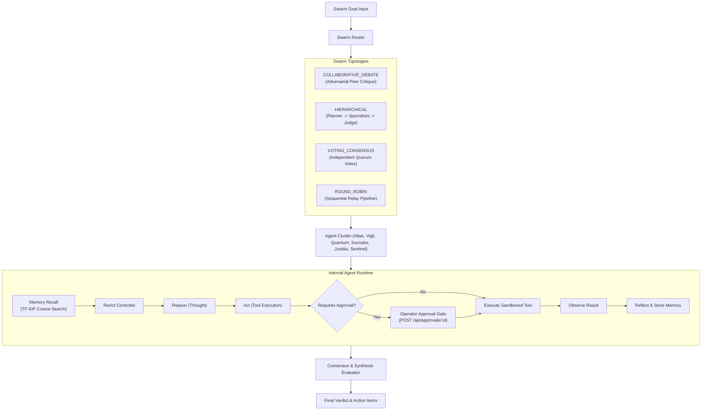
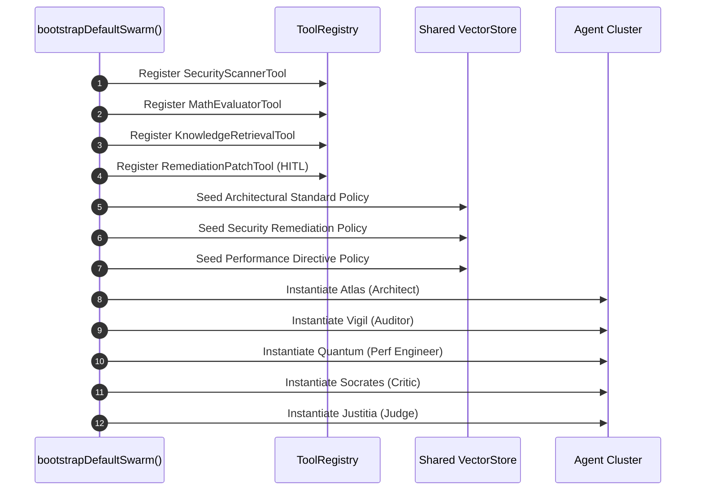

# AgentMesh Engine — Agent Skill & Orchestration Guide

**AgentMesh** is an industrial-grade, zero-dependency TypeScript engine designed for coordinated multi-agent consensus, structured deliberation, and verified deterministic execution. It eliminates single-agent hallucinations and chaotic loops by structuring tasks into formal topologies with episodic vector memory and Human-in-the-Loop (HITL) tool governance.

---

## 📑 Table of Contents

1. [Architecture & Topology Matrix](#1-architecture--topology-matrix)
2. [Agent Persona System](#2-agent-persona-system)
3. [ReAct Reflection Loop & Guardrails](#3-react-reflection-loop--guardrails)
4. [Pure TypeScript Episodic Vector Memory](#4-pure-typescript-episodic-vector-memory)
5. [Sandboxed Tool Registry & HITL Governance](#5-sandboxed-tool-registry--hitl-governance)
6. [Project Seeder Breakdown](#6-project-seeder-breakdown)
7. [Programmatic Recipes](#7-programmatic-recipes)
8. [REST & WebSocket API Reference](#8-rest--websocket-api-reference)
9. [Verification & Debugging Runbook](#9-verification--debugging-runbook)

---

## 1. Architecture & Topology Matrix



### Topology Comparison

| Topology | Turn Pattern | Stopping Condition | Recommended Use Cases |
| :--- | :--- | :--- | :--- |
| **`COLLABORATIVE_DEBATE`** | Proponent $\leftrightarrow$ Critic $\rightarrow$ Judge | Confidence score $\ge 0.60$ or max rounds | Architectural reviews, RFC trade-offs, security audits |
| **`HIERARCHICAL`** | Leader $\rightarrow$ Domain Specialists $\rightarrow$ Judge | All specialist tasks resolved | Incident triage, bug investigation, root-cause analysis |
| **`VOTING_CONSENSUS`** | Parallel / Sequential quorum polling | Supermajority agreement ($> 50\%$) | Compliance checks, risk sign-offs, go/no-go gates |
| **`ROUND_ROBIN`** | Ordered ring relay ($1 \rightarrow 2 \rightarrow 3 \rightarrow 1$) | Max rounds reached | Multi-pass code review, multi-perspective editing |

---

## 2. Agent Persona System

Every agent in AgentMesh is bound to an immutable `AgentPersona` that strictly delineates its cognitive role, system prompt, temperature, and permitted tools:

```typescript
export interface AgentPersona {
  id: string;
  name: string;
  role: AgentRole;
  avatar: string;
  color: string;
  systemPrompt: string;
  temperature?: number;
  allowedTools: string[];
}
```

### Built-in Personas

| Persona ID | Display Name | Role | Epistemic Bias | Permitted Tools |
| :--- | :--- | :--- | :--- | :--- |
| `agent-architect` | **Atlas** | `architect` | Scalability, resilience, clean modular boundaries | `knowledge_search`, `math_evaluator` |
| `agent-auditor` | **Vigil** | `auditor` | Zero-trust, OWASP Top 10, sanitization, CVEs | `security_scanner`, `knowledge_search` |
| `agent-perf` | **Quantum** | `engineer` | P95 latency, tail latencies, concurrency bottlenecks | `math_evaluator`, `knowledge_search` |
| `agent-critic` | **Socrates** | `critic` | Falsification, hidden failure modes, edge cases | `knowledge_search` |
| `agent-judge` | **Justitia** | `judge` | Impartial synthesis, confidence scoring, arbitration | `math_evaluator`, `knowledge_search` |
| `agent-incident` | **Sentinel** | `specialist` | Blast radius, fast triage, emergency remediation | `security_scanner`, `knowledge_search`, `apply_remediation_patch` |

---

## 3. ReAct Reflection Loop & Guardrails

Specialist agents execute an internal multi-step ReAct loop before emitting debate turns:
$$\text{Task Goal} \longrightarrow \text{Reason} \longrightarrow \text{Act} \longrightarrow \text{Observe} \longrightarrow \text{Reflect} \longrightarrow \text{Synthesize}$$

### Guardrails Enforced:
1. **Tool Access Permission Check:** If an agent attempts to invoke a tool outside `persona.allowedTools`, the call throws a permission error immediately.
2. **Cycle Signature Detection:** Tracks signatures of `toolName:hash(args)`. If the exact same call repeats, the loop breaks early to prevent infinite recursion.
3. **Hard Max Iterations:** Configurable iteration budget (default: 4 iterations) with strict millisecond timeouts (default: 15,000ms).
4. **Graceful Fallback:** If a tool call fails or times out, the error is passed back as an observation, allowing the agent to reflect and adapt.

---

## 4. Pure TypeScript Episodic Vector Memory

AgentMesh includes a zero-dependency vector store using Term Frequency-Inverse Document Frequency (TF-IDF) projections with Cosine Similarity ranking:

### Formulae:
- **Term Frequency:** $\text{TF}(t, d) = \frac{f_{t,d}}{\sum_{t'} f_{t',d}}$
- **Inverse Document Frequency:** $\text{IDF}(t) = \ln\left(\frac{N + 1}{df_t + 1}\right) + 1$
- **Cosine Similarity:**
$$\text{Cosine}(\mathbf{q}, \mathbf{d}) = \frac{\mathbf{q} \cdot \mathbf{d}}{\|\mathbf{q}\| \|\mathbf{d}\|}$$

### Features:
- Stopword elimination across 100+ standard English stopwords.
- Tokenization with punctuation stripping and length filtering ($> 2$ characters).
- Sub-millisecond similarity recall (~0.05ms) across episodic memories.
- Agent-isolated or swarm-wide shared vector stores.

---

## 5. Sandboxed Tool Registry & HITL Governance

Every tool in AgentMesh is registered with a typed JSON schema, description, execution closure, and optional `requiresApproval` flag:

```typescript
export interface ToolDefinition<TArgs = Record<string, any>, TResult = any> {
  name: string;
  description: string;
  requiresApproval?: boolean;
  parameters: Record<string, ToolParamSchema>;
  execute: (args: TArgs, context: ToolExecutionContext) => Promise<TResult>;
}
```

### Human-in-the-Loop Workflow:
1. An agent selects a high-stakes tool (`apply_remediation_patch`).
2. `ToolRegistry.executeTool()` detects `requiresApproval === true`.
3. Execution pauses and enters an asynchronous Promise awaiting operator resolution.
4. An `APPROVAL_REQUIRED` event is broadcast via WebSockets to the Web Visualizer.
5. The operator reviews tool arguments and submits `POST /api/approvals/:id` with `{ approved: true }`.
6. The Promise resolves, tool executes sandboxed, and observations return to the agent.

---

## 6. Project Seeder Breakdown

The AgentMesh engine seeds its initial state deterministically via `bootstrapDefaultSwarm()` located in [`src/scenarios/security-audit-swarm.ts`](file:///c:/Users/ofwit/OneDrive/Desktop/basic%20knowledge/simple%20github%20projects/AgentMesh/src/scenarios/security-audit-swarm.ts).

### Seeder Sequence:



### Detailed Component Seeder Breakdown:

#### 1. Tool Mesh Seeding
| Tool Name | Parameters | Sandboxed Capability | Requires Sign-Off |
| :--- | :--- | :--- | :---: |
| `security_scanner` | `codeSnippet: string, language: string` | Scans for OWASP flaws, hardcoded credentials, prototype pollution | No |
| `math_evaluator` | `expression: string` | Deterministic arithmetic evaluator with identifier allow-list sandbox | No |
| `knowledge_search` | `query: string, domain: string` | Retrieves internal RFC standards across architecture, security, perf | No |
| `apply_remediation_patch` | `targetService: string, patchAction: string, reason: string` | Deploys hotfixes and emergency infrastructure patches | **Yes (HITL)** |

#### 2. Vector Memory Seeding (Episodic Knowledge Base)
The seeder injects three core institutional knowledge vectors into the shared vector store:
1. **Architectural Policy:** *"Architectural Standard: Distributed swarms must validate external inputs and never pass unescaped variables to dynamic execution contexts."*
2. **Security Policy:** *"Security Policy: All vulnerabilities classified as HIGH severity must be remediated before production sign-off."*
3. **Performance Directive:** *"Performance Directive: Critical payment and authentication pathways must maintain sub-100ms processing budgets."*

These vectors immediately prime the cosine similarity search, allowing agents to ground their reasoning against official organizational standards.

#### 3. Agent Cluster Seeding
The default cluster seeds 5 balanced personas:
- **Atlas** (Lead Architect) $\rightarrow$ System boundaries and trade-offs.
- **Vigil** (Security Auditor) $\rightarrow$ Automated vulnerability detection.
- **Quantum** (Performance Engineer) $\rightarrow$ Latency and queue analysis.
- **Socrates** (Dialectic Critic) $\rightarrow$ Edge cases and stress-testing.
- **Justitia** (Consensus Judge) $\rightarrow$ Objective synthesis and ruling.

#### 4. Demo Goals Seeding
The seeder registers 3 production-grade scenarios in `DEMO_GOALS`:
1. `goal-security-audit`: *"Audit Payment Gateway for SQL Injection & Prototype Flaws"* (4 rounds, Collaborative Debate).
2. `goal-perf-review`: *"Evaluate P95 Latency & Concurrency Bottlenecks"* (3 rounds, Collaborative Debate).
3. `goal-incident-triage`: *"Live Incident Triage & Emergency Patch Deliberation"* (4 rounds, Hierarchical with Sentinel).

---

## 7. Programmatic Recipes

### Recipe 1: Launching a Custom Swarm in TypeScript

```typescript
import { bootstrapDefaultSwarm, SwarmGoal, SwarmTopology } from 'agentmesh-swarm';

const orchestrator = bootstrapDefaultSwarm();

// Subscribe to real-time events
orchestrator.subscribeEvents((event) => {
  console.log(`[${event.type}] Agent: ${event.agentId || 'SYSTEM'}`);
});

// Define custom problem goal
const goal: SwarmGoal = {
  id: 'goal-db-migration',
  title: 'Zero-Downtime PostgreSQL Schema Migration with Distributed Locks',
  description: 'Evaluate blue-green database migration safety with advisory locks.',
  maxRounds: 4,
  requireConsensus: true,
};

// Execute debate
const instance = await orchestrator.executeSwarm(goal, 'COLLABORATIVE_DEBATE');

console.log(`Status:     ${instance.status}`);
console.log(`Consensus:  ${instance.verdict?.reached ? 'REACHED' : 'DISSENT'}`);
console.log(`Confidence: ${(instance.verdict?.confidenceScore || 0) * 100}%`);
console.log(`Verdict:    ${instance.verdict?.synthesis}`);
```

### Recipe 2: Adding a Custom Tool with Schema Validation

```typescript
import { ToolDefinition } from 'agentmesh-swarm';

export const DNSLookupTool: ToolDefinition<{ hostname: string }> = {
  name: 'dns_lookup',
  description: 'Resolves IP addresses and SRV records for internal service discovery.',
  requiresApproval: false,
  parameters: {
    hostname: {
      type: 'string',
      description: 'Domain name to resolve',
      required: true,
    },
  },
  execute: async ({ hostname }, ctx) => {
    ctx.log(`Resolving DNS for ${hostname}...`);
    return { hostname, addresses: ['10.0.1.42', '10.0.1.43'], ttl: 300 };
  },
};
```

---

## 8. REST & WebSocket API Reference

The server runs on **port 3040** by default (`http://localhost:3040`).

### REST API Endpoints

| Method | Endpoint | Request Body | Description |
| :--- | :--- | :--- | :--- |
| `GET` | `/api/health` | None | Engine health, uptime, memory RSS |
| `GET` | `/api/metrics` | None | Execution counts, throughput, consensus rate |
| `GET` | `/api/agents` | None | Registered agent personas & tool permissions |
| `GET` | `/api/tools` | None | Registered tools & parameter schemas |
| `GET` | `/api/goals` | None | Pre-configured demonstration scenarios |
| `GET` | `/api/swarms` | None | Historical and active swarm instances |
| `POST` | `/api/swarms` | `{ goal: string \| SwarmGoal, topology?: string, maxTurns?: number }` | Launch swarm (accepts simple or full goal) |
| `GET` | `/api/swarms/:id` | None | Get swarm transcript, tool executions, verdict |
| `POST` | `/api/swarms/:id/cancel` | None | Abort running swarm immediately |
| `GET` | `/api/memory` | Optional query `?q=...` | Retrieve all memories or query top-5 |
| `POST` | `/api/memory/search` | `{ query: string, topK?: number }` | Semantic vector cosine search |
| `GET` | `/api/approvals` | None | List pending HITL approval requests |
| `POST` | `/api/approvals/:id` | `{ approved: boolean }` | Approve or reject pending HITL action |

### WebSocket Telemetry (`ws://localhost:3040/ws`)
- **Connection Init:** Receives `INIT_STATE` snapshot containing agents, tools, instances, pending approvals, and engine metrics.
- **Event Streaming:** Streams `SWARM_EVENT` with real-time lifecycle transitions:
  - `SWARM_STARTED` $\rightarrow$ `AGENT_THINKING` $\rightarrow$ `TOOL_INVOKED` $\rightarrow$ `APPROVAL_REQUIRED` $\rightarrow$ `AGENT_MESSAGE` $\rightarrow$ `CONSENSUS_EVALUATED` $\rightarrow$ `SWARM_COMPLETED`.

---

## 9. Verification & Debugging Runbook

### Diagnostic Commands

```bash
# 1. Typecheck TypeScript strictly
npm run typecheck

# 2. Execute unit and integration tests (13/13 native tests)
npm test

# 3. Run synthetic load benchmark (15 swarms)
npm run bench

# 4. Run individual scenario demonstrations
npm run example:audit    # Security audit scenario
npm run example:debate   # Dialectic debate scenario
npm run example:triage   # Emergency incident triage scenario

# 5. Launch Web Visualizer
npm run start -- --port 3040
```
