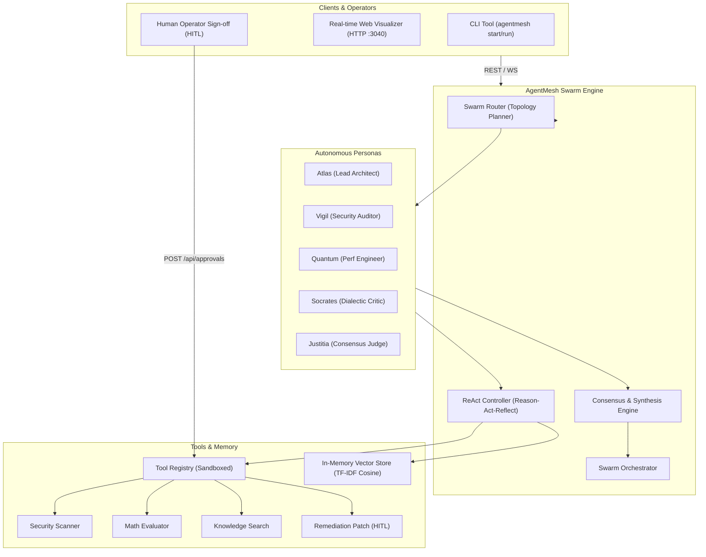

# AgentMesh — System Architecture & Swarm Specifications

AgentMesh is an autonomous multi-agent swarm orchestrator and task mesh runtime engineered with **zero external runtime dependencies** (Node.js 20+ native and `ws`).

---

## 1. High-Level Architecture Overview

---

## 2. Swarm Topologies

AgentMesh supports four deterministic communication topologies:

### A. Collaborative Debate (`COLLABORATIVE_DEBATE`)
- Two or more agents deliberate dialectically across $N$ rounds.
- Proponent agents defend the architectural proposal while Critic agents identify edge-case vulnerabilities, performance regressions, and flawed assumptions.
- An Executive Judge agent listens to all arguments and delivers an authoritative consensus verdict.

### B. Hierarchical Delegation (`HIERARCHICAL`)
- A Lead Architect/Planner agent decomposes a high-level goal into domain-specific sub-tasks.
- Specialist agents (Security Auditor, Performance Engineer) execute tasks using their permitted tools.
- A Judge agent synthesizes all specialist findings into an executive decision.

### C. Voting Consensus (`VOTING_CONSENSUS`)
- All agents evaluate the goal concurrently and cast votes.
- The `ConsensusEvaluator` computes a confidence score ($0.0 \dots 1.0$) and measures supporting vs. dissenting agents.

### D. Round-Robin Relay (`ROUND_ROBIN`)
- Sequential message passing where Agent $A$ hands off partial results to Agent $B$, continuing until max rounds settle.

---

## 3. In-Memory Vector Store & Semantic Memory

Unlike systems requiring external databases (Pinecone, Chroma, Qdrant), AgentMesh includes an in-memory vector store:
1. **Tokenization & Stopword Stripping**: Normalizes input text and eliminates high-frequency noise words.
2. **TF-IDF Projection**: Computes term frequency normalized by document frequency across the agent's episodic experiences.
3. **Cosine Similarity**: Ranks memories using $\frac{\vec{A} \cdot \vec{B}}{\|\vec{A}\| \|\vec{B}\|}$ with sub-millisecond retrieval latency.

---

## 4. ReAct Reflection Loop & Guardrails

Specialist agents execute tasks using the ReAct (Reason $\rightarrow$ Act $\rightarrow$ Observe $\rightarrow$ Reflect) paradigm:
- **Permission Boundary**: Agents can only invoke tools explicitly granted in their persona schema.
- **Cycle Guard**: Detects repeated tool calls with identical arguments to break infinite loops.
- **Human-in-the-Loop (HITL)**: High-stakes operations (e.g., `apply_remediation_patch`) pause execution and await explicit operator sign-off via REST/WebSocket.
