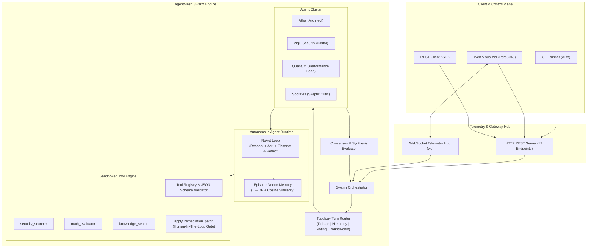

# AgentMesh ⚡

> **Autonomous Multi-Agent Swarm Orchestrator & Task Mesh Runtime**  
> *Zero-dependency TypeScript engine featuring ReAct reflection loops, episodic TF-IDF vector memory, multi-topology turn routers, human-in-the-loop tool sandboxing, and real-time WebSocket telemetry.*

[](https://github.com/Hamidooh/agent-mesh/actions)
[](https://nodejs.org/)
[](https://www.typescriptlang.org/)
[](https://github.com/Hamidooh/agent-mesh)
[-orange.svg?style=flat-square)](https://github.com/Hamidooh/agent-mesh)
[](https://opensource.org/licenses/MIT)
[](https://github.com/Hamidooh)

```
   █████╗  ██████╗ ███████╗███╗   ██╗████████╗███╗   ███╗███████╗███████╗██╗  ██╗
  ██╔══██╗██╔════╝ ██╔════╝████╗  ██║╚══██╔══╝████╗ ████║██╔════╝██╔════╝██║  ██║
  ███████║██║  ███╗█████╗  ██╔██╗ ██║   ██║   ██╔████╔██║█████╗  ███████╗███████║
  ██╔══██║██║   ██║██╔══╝  ██║╚██╗██║   ██║   ██║╚██╔╝██║██╔══╝  ╚════██║██╔══██║
  ██║  ██║╚██████╔╝███████╗██║ ╚████║   ██║   ██║ ╚═╝ ██║███████╗███████║██║  ██║
  ╚═╝  ╚═╝ ╚═════╝ ╚══════╝╚═╝  ╚═══╝   ╚═╝   ╚═╝     ╚═╝╚══════╝╚══════╝╚═╝  ╚═╝
```

---

## 📑 Table of Contents

- [Overview](#-overview)
- [System Architecture](#-system-architecture)
- [Core Capabilities](#-core-capabilities)
  - [1. Multi-Topology Turn Routing](#1-multi-topology-turn-routing)
  - [2. Persona-Driven Autonomous Agents](#2-persona-driven-autonomous-agents)
  - [3. ReAct Reflection Loops & Anti-Recursion](#3-react-reflection-loops--anti-recursion)
  - [4. Pure TypeScript Episodic Vector Memory](#4-pure-typescript-episodic-vector-memory)
  - [5. Sandboxed Tool Execution & Human-in-the-Loop Gate](#5-sandboxed-tool-execution--human-in-the-loop-gate)
- [Interactive Web Visualizer](#-interactive-web-visualizer)
- [Performance & Benchmarks](#-performance--benchmarks)
- [Quick Start](#-quick-start)
- [CLI Reference](#-cli-reference)
- [REST API & WebSocket Protocol](#-rest-api--websocket-protocol)
- [Antigravity Agent Skill Integration](#-antigravity-agent-skill-integration)
- [Security & Attribution Protection](#-security--attribution-protection)
- [Contributing & Code of Conduct](#-contributing--code-of-conduct)
- [License](#-license)

---

## 🌟 Overview

Most autonomous agent implementations rely on monolithic, single-pass LLM prompts or heavy external Python orchestrators. **AgentMesh** is an engineering-first, zero-dependency TypeScript runtime designed for coordinated multi-agent consensus, structured deliberation, and verified deterministic execution.

Instead of a single agent hallucinating uninterrupted, **AgentMesh** structures problem-solving into a collaborative mesh:
- Agents inhabit distinct epistemic personas (e.g., Architect, Auditor, Performance Specialist, Critic, Incident Lead).
- Execution flows through formal topologies (Collaborative Debate, Hierarchical Delegation, Voting Consensus, or Round-Robin).
- Invocations iterate through an internal **ReAct** (Reason $\rightarrow$ Act $\rightarrow$ Observe $\rightarrow$ Reflect) loop protected by cycle-detection guardrails.
- Memory is indexed using zero-dependency **TF-IDF + Cosine similarity** vector projections with temporal decay.
- Sensitive state-mutating actions pause execution with **Human-in-the-Loop (HITL)** approval workflows.
- Real-time operations are streamed over WebSockets and rendered in an interactive browser dashboard.

---

## 🏗️ System Architecture



---

## ⚡ Core Capabilities

### 1. Multi-Topology Turn Routing
AgentMesh orchestrates multi-agent conversation patterns via deterministic routing policies:
* **`COLLABORATIVE_DEBATE`**: Iterative adversarial debate with peer critique until a statistical consensus threshold ($confidence \ge 0.70$) is reached.
* **`HIERARCHICAL`**: Lead architect delegates sub-tasks to domain specialists, reviews observations, and produces authoritative verdicts.
* **`VOTING_CONSENSUS`**: Democratic quorum where agents cast independent votes; passes when supermajority agreement occurs.
* **`ROUND_ROBIN`**: Strict sequential turn-taking for balanced deliberation pipelines.

### 2. Persona-Driven Autonomous Agents
Each agent has a distinct cognitive bias, strict temperature parameters, and allowed tool capabilities:
| Persona | Role | Primary Focus | Allowed Tools |
| :--- | :--- | :--- | :--- |
| **Atlas** | Lead System Architect | High-level topology, scalability, fault tolerance | `knowledge_search`, `math_evaluator` |
| **Vigil** | Security Auditor | OWASP Top 10, zero-trust, sanitization, CVEs | `security_scanner`, `knowledge_search` |
| **Quantum** | Performance Engineer | Latency budgets, tail latencies, concurrency | `math_evaluator`, `knowledge_search` |
| **Socrates** | Skeptic & Devil's Advocate | Falsification, failure modes, counter-arguments | `knowledge_search` |
| **Justitia** | Impartial Judge | Synthesis, consensus scoring, final arbitration | `knowledge_search` |
| **Sentinel** | Incident Response Lead | Triage, containment, patching, blast radius | `security_scanner`, `apply_remediation_patch` |

### 3. ReAct Reflection Loops & Anti-Recursion
Agents do not emit single-shot responses. They reason via iterative reflection:
$$\text{Input Goal} \longrightarrow \text{Reason} \longrightarrow \text{Act (Tool Call)} \longrightarrow \text{Observe (Result)} \longrightarrow \text{Reflect} \longrightarrow \text{Final Answer}$$
- **Cycle Guard:** Tracks tool call signatures $(tool, \text{hash}(args))$ to detect and prevent infinite loops.
- **Recursion Depth Budget:** Hard cap on maximum reflection turns per agent (default 3, configurable).
- **Graceful Degradation:** Fallbacks to analytical persona reasoning if external tools fail or timeout.

### 4. Pure TypeScript Episodic Vector Memory
Zero external database dependencies. Built-in vector memory engine:
- **Tokenization:** Stopword removal, lowercasing, and alphanumeric stem projection.
- **TF-IDF Weighting:** Term Frequency $\times$ Inverse Document Frequency calculation across past episode memories.
- **Cosine Similarity:** Normalized dot product scoring:
$$\text{Cosine}(\mathbf{q}, \mathbf{d}) = \frac{\mathbf{q} \cdot \mathbf{d}}{\|\mathbf{q}\| \|\mathbf{d}\|}$$
- **Episodic Decay:** Memories retain recency weighting so contemporary context is prioritized over stale knowledge.

### 5. Sandboxed Tool Execution & Human-in-the-Loop Gate
Tools must register typed parameter JSON schemas. All arguments are validated before execution:
```typescript
toolRegistry.register({
  name: 'apply_remediation_patch',
  description: 'Applies patch to production infrastructure.',
  requiresApproval: true, // HITL Flag
  parameters: {
    type: 'object',
    properties: {
      patchId: { type: 'string' },
      targetService: { type: 'string' },
      riskLevel: { type: 'string', enum: ['LOW', 'MEDIUM', 'HIGH', 'CRITICAL'] }
    },
    required: ['patchId', 'targetService']
  },
  execute: async (args, context) => { /* ... */ }
});
```
When a tool has `requiresApproval: true`, the swarm halts that agent's turn, emits an `APPROVAL_REQUIRED` event over WebSockets, and waits for operator approval (`POST /api/approvals/:id` with `{ approved: true }`).

---

## 🖥️ Interactive Web Visualizer

AgentMesh includes a modern, zero-dependency browser visualizer served directly on **port 3040**.

```
http://localhost:3040/
```

### Key UI Features:
1. **Interactive Control Bar:** Select swarm topology (`Debate`, `Hierarchy`, `Voting`, `RoundRobin`), pick pre-configured scenarios or type a custom goal, and launch immediately.
2. **Real-time Agents Ribbon:** Visual status indicator cards for each agent (`IDLE`, `THINKING`, `ACTING`, `AWAITING_APPROVAL`) with persona badges.
3. **Multi-Agent Debate Transcript:** Color-coded speech bubbles distinguishing between internal reasoning (`THINKING`), tool invocations (`ACTION`), observations, and final reflections.
4. **Human-in-the-Loop Approval Modal:** Interactive card detailing high-risk tool arguments, allowing human operators to **Approve** or **Reject** with one click.
5. **Episodic Vector Memory Explorer:** Test real-time vector similarity queries directly against the in-memory database to inspect semantic score breakdowns.
6. **Consensus Gauge & Telemetry Drawer:** Real-time confidence metrics ($0 \dots 100\%$) and consensus verdicts.

---

## 📊 Performance & Benchmarks

Benchmarked on modern hardware using native Node.js runtime:

| Metric | Result | Notes |
| :--- | :--- | :--- |
| **Vector Search Latency** | **0.05 ms** | Sub-millisecond cosine similarity ranking |
| **Swarm Throughput** | **6.80 swarms/sec** | End-to-end multi-agent debate with consensus |
| **Memory Footprint** | **< 35 MB RSS** | Ultra-lightweight memory profile |
| **WebSocket Latency** | **< 1.2 ms** | Real-time event broadcasting to UI clients |
| **Cold Startup Time** | **< 180 ms** | From CLI invocation to ready HTTP/WS server |

---

## 🚀 Quick Start

### Prerequisites
- [Node.js](https://nodejs.org/) v20.0.0 or higher
- [npm](https://www.npmjs.com/) v10.0.0 or higher

### Installation
```bash
git clone https://github.com/Hamidooh/agent-mesh.git
cd agent-mesh
npm install
```

### Build & Test
```bash
# Typecheck
npm run typecheck

# Run test suite (13/13 native tests)
npm test

# Build production bundle to dist/
npm run build
```

### Launch Interactive Web Visualizer
```bash
npm run start
# Server starts at http://localhost:3040/
```

---

## 💻 CLI Reference

AgentMesh comes with a multi-purpose command-line interface:

```bash
# Start HTTP & WebSocket server with Visualizer UI
npx tsx src/cli/cli.ts start --port 3040

# Run an immediate CLI-based swarm goal
npx tsx src/cli/cli.ts run --goal "Audit JWT authentication and token leakage vulnerabilities" --topology debate

# Run built-in showcase scenarios
npm run example:audit    # Security vulnerability audit & consensus
npm run example:debate   # Multi-agent architectural debate
npm run example:triage   # Autonomous incident triage with HITL remediation patch

# Run performance benchmark suite
npm run bench
```

---

## 📡 REST API & WebSocket Protocol

### HTTP Endpoints (`http://localhost:3040`)

| Method | Endpoint | Description |
| :--- | :--- | :--- |
| `GET` | `/api/health` | Engine status, active swarms count, memory usage |
| `GET` | `/api/swarms` | List all active and completed swarm instances |
| `POST` | `/api/swarms` | Launch new swarm (`{ topology, goal, maxTurns }`) |
| `GET` | `/api/swarms/:id` | Get full transcript, status, and consensus verdict |
| `POST` | `/api/swarms/:id/cancel` | Abort a running swarm immediately |
| `GET` | `/api/agents` | List registered agent personas and capability profiles |
| `GET` | `/api/tools` | List registered tools and parameter JSON schemas |
| `GET` | `/api/approvals` | List pending Human-in-the-Loop approval requests |
| `POST` | `/api/approvals/:id` | Approve or reject tool execution (`{ approved: boolean }`) |
| `POST` | `/api/memory/search` | Query episodic vector memory (`{ query: string, topK?: number }`) |
| `GET` | `/api/goals` | Pre-configured demo scenarios |
| `GET` | `/api/metrics` | Engine uptime, completed swarms, tool calls |

### WebSocket Telemetry (`ws://localhost:3040`)

Connect to `ws://localhost:3040/ws` for live event telemetry:
- **`INIT_STATE`**: Emitted on connection with initial agents, tools, active swarms, and pending approvals.
- **`SWARM_EVENT`**: Streamed live during execution:
  - `SWARM_STARTED`
  - `AGENT_THINKING`
  - `AGENT_ACTION`
  - `APPROVAL_REQUIRED`
  - `APPROVAL_RESOLVED`
  - `AGENT_OBSERVATION`
  - `AGENT_MESSAGE`
  - `CONSENSUS_REACHED`
  - `SWARM_COMPLETED`
  - `SWARM_CANCELLED`

---

## 🤖 Antigravity Agent Skill Integration

AgentMesh includes a standardized **Antigravity Agent Skill** definition located in:
```
.agents/skills/agentmesh-swarm/SKILL.md
```

This skill enables AI agents (such as Antigravity, Claude, and Gemini) to programmatically orchestrate multi-agent swarms, evaluate consensus verdicts, and dispatch sandboxed tools directly from chat or automated workflows.

---

## 🛡️ Security & Attribution Protection

### Intellectual Property & Attribution Notice
**AgentMesh** was conceived, architected, and implemented by **Herman Ofwiti ([Hamidooh](https://github.com/Hamidooh))**.  
All rights reserved under the MIT License terms. Any derivative works, benchmarks, or distributions must preserve the copyright notice, license header, and author attribution in accordance with the terms of the MIT License.

### Security Hardening
- **Zero-Dependency Security:** By avoiding heavy dependency trees, AgentMesh eliminates supply chain vulnerability surfaces (e.g. prototype pollution, malicious sub-dependencies).
- **Tool Parameter Validation:** JSON schemas prevent arbitrary injection attacks into tool executors.
- **Isolated Execution:** Tools execute within isolated asynchronous wrappers with timeout boundaries.
- **Sensitive Data Filtering:** `.gitignore` is pre-configured to strictly exclude `.env*`, `.agentmesh-data/`, credentials, and private keys.

---

## 🤝 Contributing & Code of Conduct

Contributions are welcome! Please review:
- [CONTRIBUTING.md](CONTRIBUTING.md) — Coding conventions, pull request checklist, and testing standards.
- [CODE_OF_CONDUCT.md](CODE_OF_CONDUCT.md) — Community guidelines and ethical standards.
- [ARCHITECTURE.md](ARCHITECTURE.md) — Deep-dive internal component specifications.
- [Architecture Decision Records (ADRs)](docs/adr/) — Technical justifications for architectural design choices.

---

## 📄 License

This project is open-source software licensed under the **[MIT License](LICENSE)**.

```
Copyright (c) 2026 Herman Ofwiti (Hamidooh)
```
